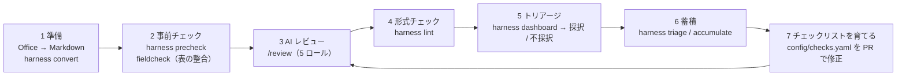

# レビューの進め方

| 手順 | やること | コマンド / 操作 |
|---|---|---|
| 1 準備 | Office の原本を Markdown にして `inputs/<種別>/` に置く。表示される警告（`loss.*` 等）を確認（変換レポートは `data/convert-reports/<種別>/` に残る）。変換に失敗したときは止まる（終了コード 3、入力・外部ソフトの問題は 2） | `harness convert 設計書.xlsx --type api` |
| 2 事前チェック | 機械で確かめられる観点（Front Matter・必須の見出し・表の列）を先に潰す。表の項目間の整合は fieldcheck | `harness precheck inputs/api/x.md --type api`、`fieldcheck validate inputs/api/x.md -r rules.yaml --table 入力` |
| 3 AI レビュー | Copilot Chat で `/review inputs/api/x.md`。5 ロールの順に観点を確かめ、結果を表で出す | Copilot Chat |
| 4 形式チェック | 結果を `reviews/YYYY-MM-DD_<対象>_result.md` に保存し、形式を確かめる | `harness lint` |
| 5 トリアージ | ダッシュボードで指摘ごとに採択 / 不採択を選び、`triage.json` を保存。判定は指摘の指紋で結び付くので、再レビューで No がずれても同じ指摘に付いたまま（[ARCHITECTURE.md](ARCHITECTURE.md#判定の結び付け指紋)） | `harness dashboard` → ブラウザで開く |
| 6 蓄積 | 判定を履歴に記録し、観点ごとの採択率と追加候補を更新 | `harness triage triage.json` → `harness accumulate` |
| 7 育てる | 採択率の低い観点（⚠）は「観点」か「無効となるケース」を直す。追加候補は観点にする | `config/checks.yaml` を PR で修正 → `harness checklists` |

## チェックリストを育てる

- **観点の追加**: `docs/check-candidates.md` の候補を見て、繰り返し出る指摘を観点にする。ID は種別略号 + 連番（変えない）。「無効となるケース」も必ず書く
- **観点の見直し**: `docs/adoption.md` の ⚠（5 件以上で採択率 30% 未満）は誤指摘が多い。観点の文や無効となるケースを具体的にする
- **観点の廃止**: ID は再利用しない。廃止する観点は削除し、PR に理由を書く
- 直したら `harness checklists` でチェックリストを作り直し、一緒にコミットする（CI が古さを検出する）

## 指摘の分析

レビュー結果（reviews/）と判定（data/history.jsonl）は quality-analytics でも読み込めます。
レビュアー別・観点別・真因別の傾向分析はそちらで行います。
